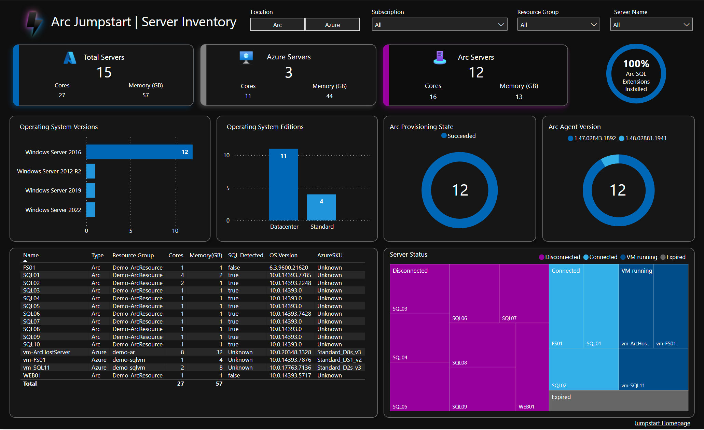
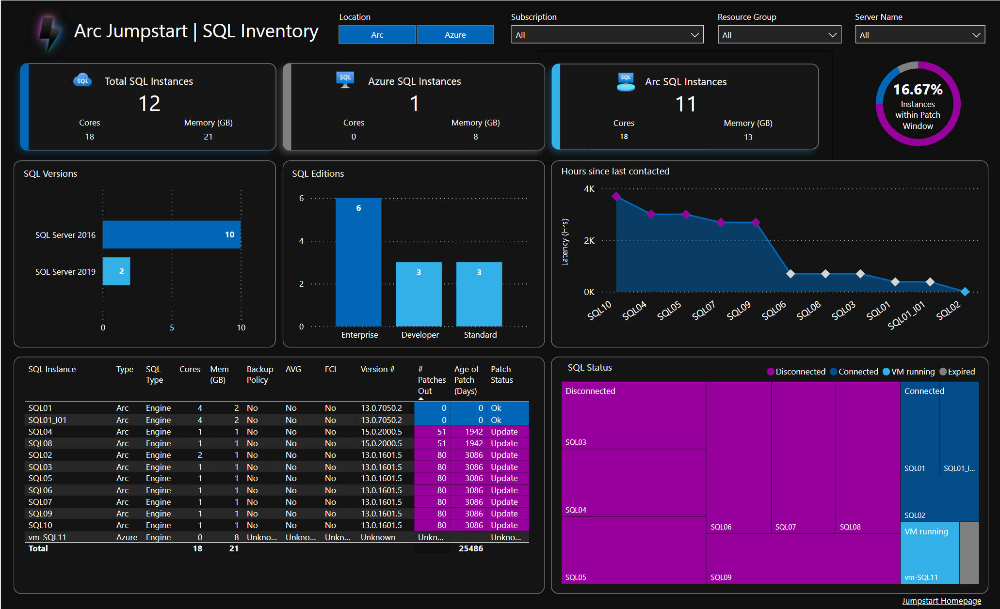
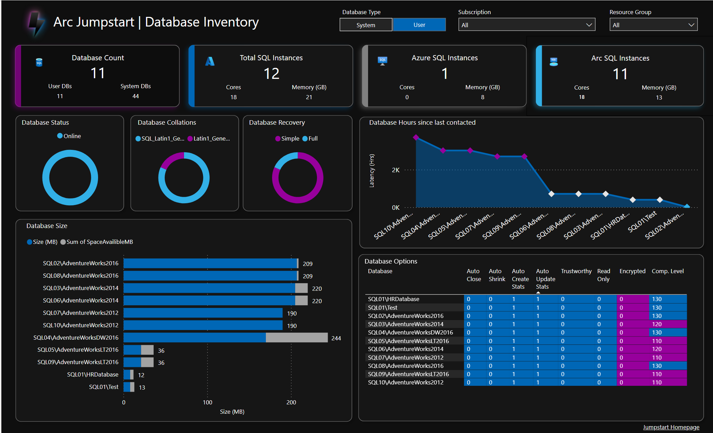
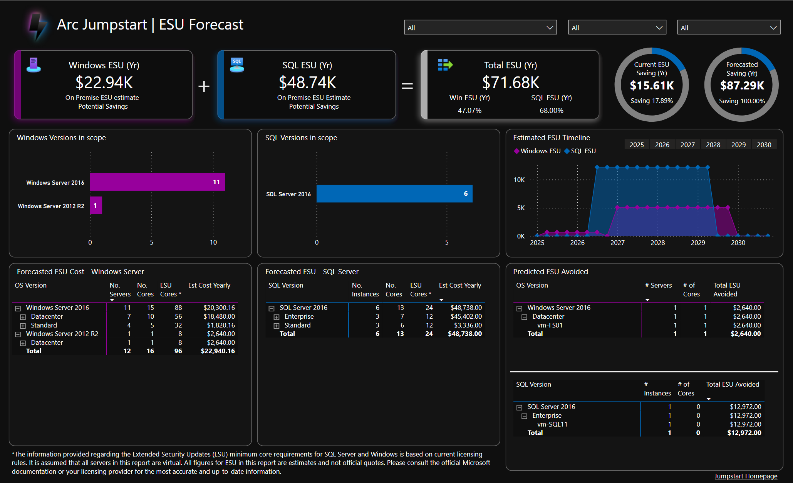
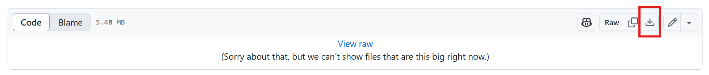
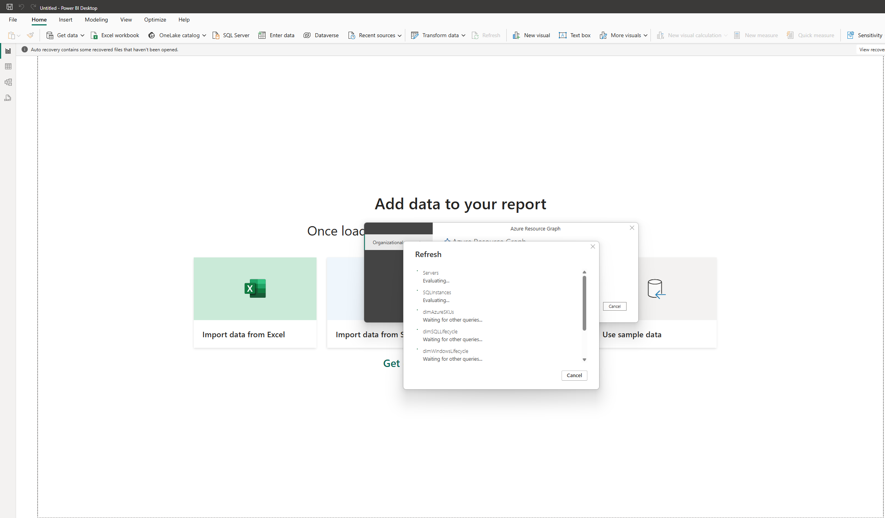
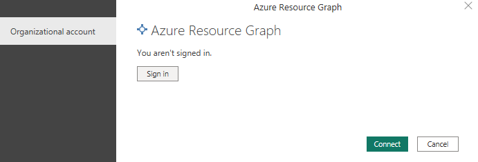
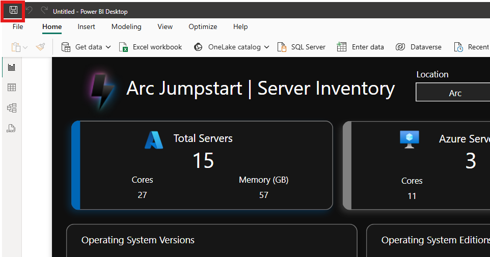

## Arc Insights PBI Dashboards Powered by Jumpstart

The download now contains the **Arc SQL estate strategy v3.5.2** template with Linux advisory enrichment, patch-evidence coverage diagnostics and machine/patch-scoped CVE advisory selection. Ubuntu reference data is downloaded automatically from a centrally updated public GitHub feed; no local JSON file, Python installation or file-path parameter is needed. The existing filename, `arc_insights_dashboard_jumpstart_V2.pbit`, is retained so existing download links continue to work. Import the template to create a new report; it does not automatically upgrade previously saved reports.

The Arc Insights Power BI (PBI) dashboards provides users with a single pane of glass insights and visualizations for your servers, enabled by Arc or as Azure virtual machines. The dashboard covers a range of scenarios including Server Inventory, SQL Instances on Virtual Machines, SQL Databases on virtual machines and Extended Security Update (ESU) cost forecasting. With the Arc Insights PBI Dashboards Powered by Jumpstart, you have a **rich set of Dashboards about your Arc connected estate, available in minutes, not weeks**, which can then be customized to suit your individual requirements.

Using Power BI over Azure out-of-the-box dashboards provides several benefits to users which include:

1. Power BI provides a platform to visualize and share your IT Infrastructure with users, without the need for Azure portal access.
2. Power BI has a rich programming language allowing for more advanced queries and joining of datasets that sit outside Azure.
3. Power BI has numerous visualization options to build feature-rich dashboards.

The Arc Insights Power BI Dashboards utilize the Power BI connector for Azure Resource Graph, which connects the dashboards to your Azure subscription(s), visualizing all your servers, whether Azure virtual machine or enabled by Azure Arc. Power BI offers a rich set of visualizations and query tools, enabling advanced scenarios such as **Extended Support Updates cost forecasting for SQL and Windows Server 2016. This insight helps you manage and prioritize your modernization projects effectively, helping to avoid the costs and risks associated with Extended Security Updates**.

The Arc Insights PBI dashboards contain:

* **Server Inventory** - A detailed inventory of all servers, both Azure and Arc-enabled, providing a clear overview of server landscape.
* **SQL Inventory** - Information on SQL instances, including both Azure SQL and SQL Servers enabled by Arc, ensuring you have a complete view of your SQL Server environment.
* **Databases** - Insights into databases managed through Azure Arc, helping you track and manage your database assets effectively.
* **Extensions** - Extension inventory and deployment coverage across Azure and Arc-enabled servers.
* **ESU Forecast** - An estimate of future costs for Extended Security Updates (ESU) for Windows Server 2016 and SQL Server 2016, based on current pricing. For detailed prices of ESUs see: [Azure Arc pricing](https://azure.microsoft.com/pricing/details/azure-arc/core-control-plane/)
* **Security Patching CVE Audit** - Patch assessment and missing-patch inventory from Azure Resource Graph, enriched with Windows and Linux vendor CVE mappings.
* **Best Practices** - SQL instance and database configuration findings derived from Arc SQL inventory, including assessment coverage gaps.

ESU and migration/licensing costs are scenario estimates, not official quotes. CVE mappings depend on available assessments and advisory coverage; the Windows mapping queries MSRC documents from the preceding 18 months. A missing mapping is not proof that a machine has no vulnerabilities. The Best Practices page does not connect to `SqlAssessment_CL`; deeper assessment evidence is reported as **Not Assessed**.

## Screenshots

The following screenshots illustrate the earlier dashboard release. Layouts and controls in v3.5.2 differ; these images do not show the new Security Patching CVE Audit or Best Practices pages.

Screenshot showing Server Inventory:



Screenshot showing SQL Server Inventory:



Screenshot showing SQL Database Inventory:



Screenshot showing ESU Forecast:



## Prerequisites

* Azure subscription(s).
* Arc-enabled servers within your Azure subscription(s). The dashboards may encounter errors on refresh if subscriptions have no Arc connected resources.
* If you have SQL Server VMs that are Arc-enabled, these will require the [SQL Server Extension](https://learn.microsoft.com/sql/sql-server/azure-arc/connect?view=sql-server-ver16&tabs=windows) to be enabled.
* Azure credential with read access to Azure Resource Graph, to the Azure Subscription. To learn more about this see [Permissions in Azure Resource Graph](https://learn.microsoft.com/azure/governance/resource-graph/overview#permissions-in-azure-resource-graph).
* Internet connectivity.
* [Microsoft Power BI Desktop](https://www.microsoft.com/power-platform/products/power-bi/downloads?msockid=0c5db1779a21637012a6a5f29bea62ee).
* **Required for Security Patching CVE Audit: configure Azure Update Manager and enable Periodic assessment (assessment scanning) on every Azure VM and Arc-enabled server you want to audit.** Connecting a server to Azure Arc alone does not enable assessment scanning. See the configuration steps below.
* Outbound access to the reference and advisory sources listed below. Advisory enrichment can increase refresh time.
* For supported Ubuntu missing-patch targets: outbound HTTPS access to the [public Ubuntu USN OVAL reference](https://raw.githubusercontent.com/chrisdoofer/arc-sql-agent/refs/heads/ubuntu-oval-data/ubuntu-usn-oval.json). Preparation and publication are centrally scheduled; report users do not run a preparation script.

### Azure Update Manager setup for Security Patching CVE Audit

The CVE audit uses Azure Update Manager assessment results published to Azure Resource Graph. Complete this setup before refreshing the audit page:

1. Review the [Azure Update Manager prerequisites](https://learn.microsoft.com/azure/update-manager/prerequisites), including supported operating systems, permissions, extensions and network access to update sources. Non-Azure servers must be connected to Azure Arc.
2. In the Azure portal, open **Azure Update Manager**, select **Machines**, select the machines in scope, and open **Update settings**. Enable **Periodic assessment** and save. Follow Microsoft's [Configure update settings](https://learn.microsoft.com/azure/update-manager/manage-update-settings) guide. For fleet-wide configuration, use [Enable periodic assessment at scale with Azure Policy](https://learn.microsoft.com/azure/update-manager/periodic-assessment-at-scale).
3. Run **Check for updates** for an initial assessment, or allow the next periodic assessment to complete. Periodic assessment checks for missing updates every 24 hours. Confirm successful assessment results in Update Manager before refreshing Power BI. See [Assessment options in Azure Update Manager](https://learn.microsoft.com/azure/update-manager/assessment-options).
4. Refresh the Power BI report after assessment results are available in Azure Resource Graph, then review the assessment coverage and timestamps for the machines in scope.

**Assessment scanning is not patch installation.** You do not need to schedule patch installation or change patch orchestration solely to populate this audit. Machines without successful, recent assessments may have missing or stale patch/CVE results; an empty audit is not evidence that they are fully patched or free of vulnerabilities.

## Getting Started

### How to install the Arc Insights PBI Dashboards

1. Download the Power BI template file: [Arc Insights PBI Dashboard](https://github.com/Azure/arc_jumpstart_drops/blob/main/ui_dashboard_workbook/arc_pbi_dashboard/arc_insights_dashboard_jumpstart_V2.pbit)

Version 3.5.2 retrieves the Ubuntu reference automatically when relevant Ubuntu missing-patch targets are present. There is no **UbuntuOvalDataPath** parameter to configure.



2. Open the Power BI template File, upon first opening the dashboard will attempt refresh. If the file won't open, check the PBIT file properties to mark it as unblocked.



3. During the refresh, Power BI will prompt for credentials for "Azure Resource Graph" as shown below:



4. Sign in with a login that has "Read" access to Azure Resource Graph for the subscription(s) you want the report to view.

5. For public web reference and advisory sources, select Anonymous authentication where prompted. Review source URLs and configure privacy levels according to your organisation's policy; do not disable privacy checks as a workaround.

6. Complete refresh, check the subscription/resource-group scope and assessment coverage, and save your new Power BI report.



### Hosted Ubuntu advisory data

Canonical [recommends OVAL exports](https://ubuntu.com/security/oval) and explicitly says [not to use the experimental Ubuntu Security API in production environments or automations](https://ubuntu.com/security/cves/about). Ubuntu enrichment therefore uses the published **USN OVAL** feeds, not the notice/CVE JSON API or scraped HTML pages.

The official feeds are bzip2-compressed XML. Power Query's documented [`Binary.Decompress`](https://learn.microsoft.com/powerquery-m/binary-decompress) formats do not include bzip2, so a centrally scheduled preparation script downloads, decompresses and validates the feeds before publishing a Power BI-readable JSON reference. The report's [Power Query reader](./artifacts/powerquery/fnUbuntuOvalSnapshot.m) uses a static HTTPS origin and fixed relative path:

<https://raw.githubusercontent.com/chrisdoofer/arc-sql-agent/refs/heads/ubuntu-oval-data/ubuntu-usn-oval.json>

The [Publish Ubuntu OVAL reference workflow](https://github.com/chrisdoofer/arc-sql-agent/actions/workflows/publish-ubuntu-oval.yaml) runs every six hours in `chrisdoofer/arc-sql-agent`, including **noble, jammy and focal**. It runs parser and publisher regression tests before preparation, then atomically updates `ubuntu-usn-oval.json` on a dedicated `ubuntu-oval-data` branch. No tenant data, Azure credentials, customer inventory or report data is used. It does not change the report or template.

The JSON contents change as Canonical adds or revises advisories. Its stable URL and versioned schema allow routine advisory updates without issuing another template. The snapshot records official source URLs, compressed-feed SHA-256 hashes, vendor generator timestamps and unsupported-rule counts. Its preparation timestamp means the feeds were retrieved and processed, **not** that Canonical published a new feed at that time. A newly published USN can appear on Canonical's website before its next OVAL export.

Only successful preparation is published. A failed update leaves the previous reference intact and fails the workflow. The report rejects references older than 24 hours, invalid files, missing required releases and missing metadata for a matched CVE rather than silently accepting incomplete or stale results. A publishing outage must be repaired by the publisher, not worked around by disabling freshness or privacy checks. Repository maintainers must monitor scheduled runs; GitHub Actions schedules can be delayed or disabled, including for inactive public repositories. This dependency is community-hosted, not a Microsoft or Canonical availability guarantee.

Configure **Anonymous** access to the public reference and privacy levels according to organisational policy. Do not disable privacy checks. No local-file gateway is needed for this reference; other report sources can still have their own refresh or gateway requirements. After publishing to Power BI Service, configure the required credentials/connections and schedule the report refresh normally.

### Maintaining or mirroring the Ubuntu reference

The publisher's [source, regression tests and operational instructions](https://github.com/chrisdoofer/arc-sql-agent/tree/main/powerbi/ubuntu-oval) live with its workflow. It publishes only from that repository's `main` branch and needs permission to update the dedicated data branch. Monitor failed runs and use manual dispatch to recover after fixing an issue. Verify Anonymous HTTP 200, all three releases and a current `generated_at` after recovery.

An organisation hosting its own mirror must update the static source in `fnUbuntuOvalSnapshot` and retain the same schema and freshness guarantees. The companion [`prepare_ubuntu_oval.py`](./prepare_ubuntu_oval.py) is retained for maintainers and private mirrors; report users do not need it. It requires Python 3.9 or later and uses only the standard library. The parser does not perform a full OVAL assessment; see the coverage limitations below.

Local template/parser regressions:

```powershell
python -m unittest discover -s .\ui_dashboard_workbook\arc_pbi_dashboard\tests -v
```

For native candidate packaging, set `ARC_INSIGHTS_TEMPLATE` to the candidate's absolute PBIT path before running the Python suite; otherwise it checks the installed repository template. Clear that environment variable afterwards. Publisher Python/Node tests run in the hosting repository.

### Data Sources Used

The Dashboard has the following data sources:
1. Azure Resource Graph - Used to gather server, SQL instance, database, extension, tag, subscription, patch assessment and Azure Migrate project inventory. The template contains its own queries. The [Azure Resource Graph Queries](https://github.com/Azure/arc_jumpstart_drops/tree/main/ui_dashboard_workbook/arc_pbi_dashboard/artifacts/arg_queries) folder contains earlier inventory examples, not a complete or exact extraction of the v3.5.2 queries.
2. [Learn.microsoft.com](https://learn.microsoft.com/) - Used to gather latest SQL Patch information
3. Reference CSVs - Azure regions, VM SKUs and extension types are loaded from this repository's [Reference CSVs](https://github.com/Azure/arc_jumpstart_drops/tree/main/ui_dashboard_workbook/arc_pbi_dashboard/artifacts/reference). The template loads its software lifecycle and ESU reference from [arc-sql-agent](https://raw.githubusercontent.com/chrisdoofer/arc-sql-agent/refs/heads/main/powerbi/Dimensions/dim_software_lifecycle.csv), not the lifecycle CSV in this Drop. These sources can change independently of the template.
4. Windows security advisories - `api.msrc.microsoft.com` provides update documents for KB-to-CVE mapping.
5. Linux security advisories - Distribution-specific enrichment uses `access.redhat.com`, `errata.almalinux.org`, `errata.rockylinux.org`, `linux.oracle.com`, `yum.oracle.com`, `security-tracker.debian.org`, `snapshot.debian.org`, `ftp.suse.com` and `www.suse.com`, depending on the patches and distributions in scope. The Ubuntu publisher retrieves official per-release feeds from `https://security-metadata.canonical.com/oval/`; the report downloads the prepared public JSON from `raw.githubusercontent.com/chrisdoofer/arc-sql-agent`. Advisory links still open `ubuntu.com`, but Ubuntu refresh does not retrieve CVE pages or use the experimental Security API.

### Interpreting Security Patching CVE Audit

The audit page is machine-scoped (`fact_resources[resource_kind] = "Server"`). SQL database and extension resources are excluded from the machine list. SQL Server updates appear against the assessed host when Update Manager reports them; adding database resources does not provide additional operating-system patch assessments.

Select a row in **All Missing Patches** to filter **CVE Advisory** to that machine and missing patch. Ctrl-select rows to include several machine/patch pairs; clear the selection to restore the current page's advisory scope. A patch with no mapped advisory produces an empty advisory table, not unrelated CVEs. This interaction uses the resource key and patch identifier together, not just the machine name or Windows KB, and applies to both Windows and Linux. It filters already-loaded evidence and does not trigger a data-source refresh.

For Windows evidence, the advisory link opens the corresponding Microsoft KB support article using `https://support.microsoft.com/help/<KB-number>`, rather than the machine-readable monthly MSRC API document. MSRC remains the source of the KB-to-CVE association and vendor severity; the link destination does not change the mapping or establish machine-specific applicability. Linux advisory links are unchanged.

Patch category, vendor priority, CVE severity and applicability answer different questions:

| Field | Meaning |
| --- | --- |
| Classification | Effective update category: Security, Critical update, Definition, Update rollup, Bug fix, Enhancement, Other or Unclassified. The original classification is retained in `classification_raw`, with its normalised value in `classification_normalised`. |
| Category source | Update Manager, Vendor advisory, Both or None. Source-reported Security is retained even without a CVE match. An Other or Unclassified update becomes Security only when an exact update-target security advisory is matched. |
| Vendor priority | The vendor's original priority or rating. In particular, Canonical priority is not a CVSS score and is not converted into CVSS severity. |
| Known severity | Highest known normalised severity among mapped CVEs. Vendor Important becomes High and Moderate becomes Medium. Where Canonical supplies a CVSS v3 or v4 score, thresholds are Critical >=9, High >=7, Medium >=4 and Low >0; the supplied CVSS version is retained. Absent evidence remains Unknown. |
| Unknown severity evidence | Indicates that some mapped evidence lacks severity, or that no severity evidence is available. A known High or Critical rating can coexist with this flag. |
| Match method and applicability | An exact update-target match associates an available update with a security fix. Candidate supersedence is a broader association and does not promote the patch category. All current CVE associations are **Inferred**, not confirmed vulnerabilities. |

**Critical updates (source) is an update category, not a count of Critical-severity CVEs.** Similarly, a kernel package name alone is not evidence that an update fixes a security issue.

Update Manager reports the available update target, not a complete installed-package inventory. The report therefore cannot prove that the installed package is affected by every associated CVE. Use the advisory links and host/package evidence to validate applicability before remediation decisions. Patch counts remain at missing-update grain; multiple CVEs for an update do not multiply its patch count.

For source semantics, see Microsoft's [Query assessment and installation logs in Azure Resource Graph](https://learn.microsoft.com/azure/update-manager/query-logs). For vendor interpretation, see [Canonical CVE information](https://ubuntu.com/security/cves/about), [Ubuntu Security Notices](https://ubuntu.com/security/notices) and [Red Hat severity classification](https://access.redhat.com/security/updates/classification).

### Linux advisory coverage and refresh diagnostics

The existing advisory adapters recognise the following releases. This is the template's adapter coverage, not an operating-system support or lifecycle statement:

| Distribution | Recognised releases |
| --- | --- |
| Ubuntu | 20.04 (focal), 22.04 (jammy), 24.04 (noble) |
| Red Hat Enterprise Linux | 7, 8, 9, 10 |
| Debian | 11 (bullseye), 12 (bookworm), 13 (trixie) |
| SUSE Linux Enterprise Server | 12 SP3-SP5; 15 SP3-SP7 |
| Oracle Linux | 7, 8, 9, 10 |
| AlmaLinux | 8, 9, 10 |
| Rocky Linux | 8, 9, 10 |

Release recognition does not guarantee coverage of every architecture, package, repository or subscription channel. Ubuntu, Red Hat and SUSE advisory searches retain a 24-month lookback; Windows MSRC mapping retains an 18-month lookback. Linux distribution discovery currently relies on Arc inventory; equivalent enrichment coverage for native Azure VMs has not been established. Review the [Azure Update Manager support matrix](https://learn.microsoft.com/azure/update-manager/support-matrix) separately.

Ubuntu exact-target and supersedence matching share buffered notice lists from the same prepared OVAL snapshot, limited to releases with relevant missing-update targets. No relevant Ubuntu targets means no Ubuntu reference download. The 24-month lookback is unchanged. Supersedence matching deduplicates package/version targets across machines and indexes advisory evidence by package before comparing Debian versions. CVE metadata is buffered within each query evaluation. The hidden Linux mapping query is a staging dependency, excluded from a separate model refresh; the status table counts already-loaded evidence instead of retrieving feeds again. Other vendors retain their existing web sources and can still increase refresh time.

**OVAL mapping is not a full OVAL assessment engine.** Preparation extracts positive binary-package `dpkginfo_test` fixed-version constraints using literal names or constant name lists. It does not evaluate Boolean applicability, architecture/Pro conditions, negated tests, kernel `uname`/computed-variable rules or Livepatch notices. Counts of unsupported tests and definitions are printed and retained in the snapshot manifest; some packages, particularly kernels, therefore remain uncovered. Even an extracted package match is **Inferred**, not proof of an installed vulnerability. Review **No match** and coverage gaps rather than treating them as successful security assessments.

The missing-patch table distinguishes **Matched**, **No match**, **Insufficient metadata**, **Unsupported release** and **Not processed**. No match means no advisory association was found within the available metadata and adapter coverage. It does **not** mean non-security, fully patched or zero risk; Unknown severity is not Low severity.

The footer shows the timestamp recorded within the last successful **full-model refresh**, in UTC, and matched-patch coverage for the current filter context. The timestamp commits with the advisory tables; it is not advanced by a calculation-only refresh. Use the normal full report/model refresh, not a selective refresh of `view_advisory_refresh_status` alone: that table is not an independent feed-health probe. **Not processed** requires a refresh. **Stale** means the last successful snapshot is more than 24 hours old. **Ready** means a recent full refresh completed, not that every patch matched or every machine is secure.

Public-feed HTTP/schema failures surface as refresh errors rather than successful empty mappings. A failed refresh can leave an earlier snapshot visible, so also check the refresh result in Desktop or refresh history in the Power BI service. Resolve the reported source, network, authentication or schema error and refresh again; do not treat an unchanged timestamp or old coverage as a successful current refresh.

Canonical USN OVAL provides per-CVE priority, CVSS score and vector metadata. The report retains the supplied CVSS v3/v4 version and uses `Canonical USN OVAL` provenance; it does not copy an advisory's overall severity to every CVE or turn Canonical priority into a numeric CVSS score. A genuinely absent score remains null/Unknown. Missing matched CVEs, malformed scores, unsupported score versions and invalid snapshots fail explicitly rather than loading blank ratings. Metadata is checked before returning the evidence table to prevent deferred cell errors. The original Power Query privacy settings are preserved; see [Power Query privacy levels](https://learn.microsoft.com/power-query/privacy-levels).

## Resources

For more information please review the following resources:

* [Azure Resource Graph](https://learn.microsoft.com/azure/governance/resource-graph/overview#permissions-in-azure-resource-graph)
* [Arc-enabled servers](https://learn.microsoft.com/azure/azure-arc/servers/overview)
* [Power BI Connector](https://learn.microsoft.com/azure/governance/resource-graph/power-bi-connector-quickstart?tabs=power-bi-desktop#connect-azure-resource-graph-with-power-bi-connector)
