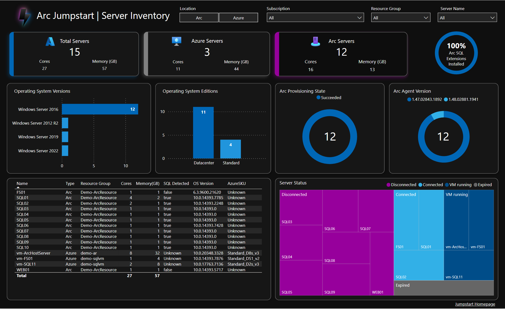
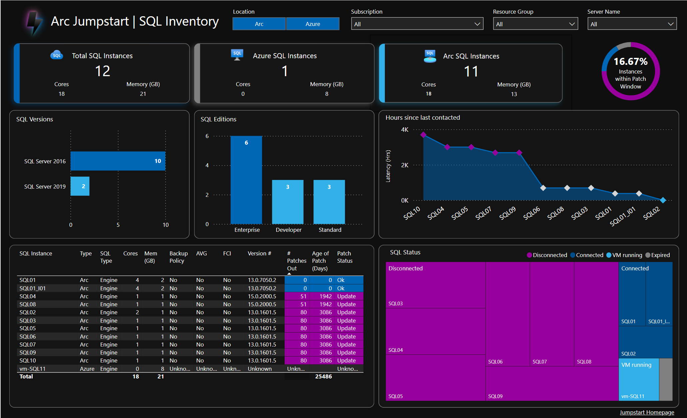
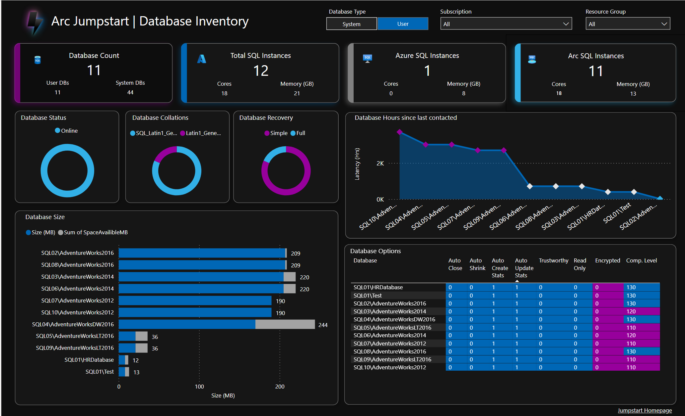
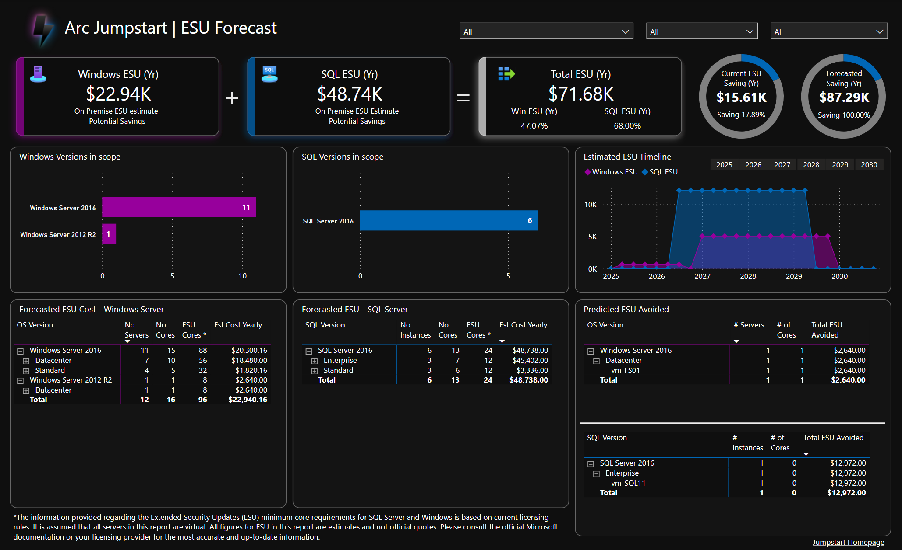
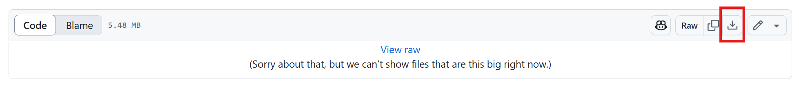
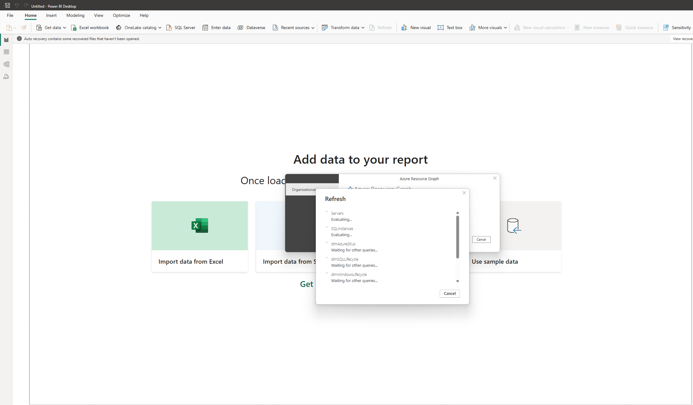
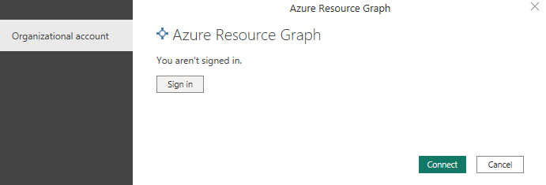
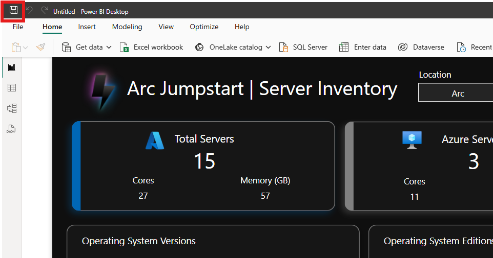

## Arc Insights PBI Dashboards Powered by Jumpstart

The download now contains the **Arc SQL estate strategy v3.5.1** template. The existing filename, `arc_insights_dashboard_jumpstart_V2.pbit`, is retained so existing download links continue to work. Import the template to create a new report; it does not automatically upgrade previously saved reports.

The Arc Insights Power BI (PBI) dashboards provides users with a single pane of glass insights and visualizations for your servers, enabled by Arc or as Azure virtual machines. The dashboard covers a range of scenarios including Server Inventory, SQL Instances on Virtual Machines, SQL Databases on virtual machines and Extended Security Update (ESU) cost forecasting. With the Arc Insights PBI Dashboards Powered by Jumpstart, you have a **rich set of Dashboards about your Arc connected estate, available in minutes, not weeks**, which can then be customized to suit your individual requirements.

Using Power BI over Azure out-of-the-box dashboards provides several benefits to users which include:

1. Power BI provides a platform to visualize and share your IT Infrastructure with users, without the need for Azure portal access.
2. Power BI has a rich programming language allowing for more advanced queries and joining of datasets that sit outside Azure.
3. Power BI has numerous visualization options to build feature-rich dashboards.

The Arc Insights Power BI Dashboards utilize the Power BI connector for Azure Resource Graph, which connects the dashboards to your Azure subscription(s), visualizing all your servers, whether Azure virtual machine or enabled by Azure Arc. Power BI offers a rich set of visualizations and query tools, enabling advanced scenarios such as **Extended Support Updates cost forecasting for SQL and Windows Server 2016. This insight helps you manage and prioritize your modernization projects effectively, helping to avoid the costs and risks associated with Extended Security Updates**.

The Arc Insights PBI dashboards contain:

* **Server Inventory** - A detailed inventory of all servers, both Azure and Arc-enabled, providing a clear overview of server landscape.
* **SQL Inventory** - Information on SQL instances, including both Azure SQL and SQL Servers enabled by Arc, ensuring you have a complete view of your SQL Server environment.
* **Databases** - Insights into databases managed through Azure Arc, helping you track and manage your database assets effectively.
* **Extensions** - Extension inventory and deployment coverage across Azure and Arc-enabled servers.
* **ESU Forecast** - An estimate of future costs for Extended Security Updates (ESU) for Windows Server 2016 and SQL Server 2016, based on current pricing. For detailed prices of ESUs see: [Azure Arc pricing](https://azure.microsoft.com/pricing/details/azure-arc/core-control-plane/)
* **Security Patching CVE Audit** - Patch assessment and missing-patch inventory from Azure Resource Graph, enriched with Windows and Linux vendor CVE mappings.
* **Best Practices** - SQL instance and database configuration findings derived from Arc SQL inventory, including assessment coverage gaps.

ESU and migration/licensing costs are scenario estimates, not official quotes. CVE mappings depend on available assessments and advisory coverage; the Windows mapping queries MSRC documents from the preceding 18 months. A missing mapping is not proof that a machine has no vulnerabilities. The Best Practices page does not connect to `SqlAssessment_CL`; deeper assessment evidence is reported as **Not Assessed**.

## Screenshots

The following screenshots illustrate the earlier dashboard release. Layouts and controls in v3.5.1 differ; these images do not show the new Security Patching CVE Audit or Best Practices pages.

Screenshot showing Server Inventory:

Screenshot showing SQL Server Inventory:

Screenshot showing SQL Database Inventory:

Screenshot showing ESU Forecast:

## Prerequisites

* Azure subscription(s).
* Arc-enabled servers within your Azure subscription(s). The dashboards may encounter errors on refresh if subscriptions have no Arc connected resources.
* If you have SQL Server VMs that are Arc-enabled, these will require the [SQL Server Extension](https://learn.microsoft.com/sql/sql-server/azure-arc/connect?view=sql-server-ver16&tabs=windows) to be enabled.
* Azure credential with read access to Azure Resource Graph, to the Azure Subscription. To learn more about this see [Permissions in Azure Resource Graph](https://learn.microsoft.com/azure/governance/resource-graph/overview#permissions-in-azure-resource-graph).
* Internet connectivity.
* [Microsoft Power BI Desktop](https://www.microsoft.com/power-platform/products/power-bi/downloads?msockid=0c5db1779a21637012a6a5f29bea62ee).
* **Required for Security Patching CVE Audit: configure Azure Update Manager and enable Periodic assessment (assessment scanning) on every Azure VM and Arc-enabled server you want to audit.** Connecting a server to Azure Arc alone does not enable assessment scanning. See the configuration steps below.
* Outbound access to the reference and advisory sources listed below. Advisory enrichment can increase refresh time.

### Azure Update Manager setup for Security Patching CVE Audit

The CVE audit uses Azure Update Manager assessment results published to Azure Resource Graph. Complete this setup before refreshing the audit page:

1. Review the [Azure Update Manager prerequisites](https://learn.microsoft.com/azure/update-manager/prerequisites), including supported operating systems, permissions, extensions and network access to update sources. Non-Azure servers must be connected to Azure Arc.
2. In the Azure portal, open **Azure Update Manager**, select **Machines**, select the machines in scope, and open **Update settings**. Enable **Periodic assessment** and save. Follow Microsoft's [Configure update settings](https://learn.microsoft.com/azure/update-manager/manage-update-settings) guide. For fleet-wide configuration, use [Enable periodic assessment at scale with Azure Policy](https://learn.microsoft.com/azure/update-manager/periodic-assessment-at-scale).
3. Run **Check for updates** for an initial assessment, or allow the next periodic assessment to complete. Periodic assessment checks for missing updates every 24 hours. Confirm successful assessment results in Update Manager before refreshing Power BI. See [Assessment options in Azure Update Manager](https://learn.microsoft.com/azure/update-manager/assessment-options).
4. Refresh the Power BI report after assessment results are available in Azure Resource Graph, then review the assessment coverage and timestamps for the machines in scope.

**Assessment scanning is not patch installation.** You do not need to schedule patch installation or change patch orchestration solely to populate this audit. Machines without successful, recent assessments may have missing or stale patch/CVE results; an empty audit is not evidence that they are fully patched or free of vulnerabilities.

## Getting Started

### How to install the Arc Insights PBI Dashboards

1. Download the Power BI template file: [Arc Insights PBI Dashboard](https://github.com/Azure/arc_jumpstart_drops/blob/main/ui_dashboard_workbook/arc_pbi_dashboard/arc_insights_dashboard_jumpstart_V2.pbit)

2. Open the Power BI template File, upon first opening the dashboard will attempt refresh. If the file won't open, check the PBIT file properties to mark it as unblocked.

3. During the refresh, Power BI will prompt for credentials for "Azure Resource Graph" as shown below:

4. Sign in with a login that has "Read" access to Azure Resource Graph for the subscription(s) you want the report to view.

5. For public web reference and advisory sources, select Anonymous authentication where prompted. Review source URLs and configure privacy levels according to your organisation's policy; do not disable privacy checks as a workaround.

6. Complete refresh, check the subscription/resource-group scope and assessment coverage, and save your new Power BI report.

### Data Sources Used

The Dashboard has the following data sources:
1. Azure Resource Graph - Used to gather server, SQL instance, database, extension, tag, subscription, patch assessment and Azure Migrate project inventory. The template contains its own queries. The [Azure Resource Graph Queries](https://github.com/Azure/arc_jumpstart_drops/tree/main/ui_dashboard_workbook/arc_pbi_dashboard/artifacts/arg_queries) folder contains earlier inventory examples, not a complete or exact extraction of the v3.5.1 queries.
2. [Learn.microsoft.com](https://learn.microsoft.com/) - Used to gather latest SQL Patch information
3. Reference CSVs - Azure regions, VM SKUs and extension types are loaded from this repository's [Reference CSVs](https://github.com/Azure/arc_jumpstart_drops/tree/main/ui_dashboard_workbook/arc_pbi_dashboard/artifacts/reference). The v3.5.1 template loads its software lifecycle and ESU reference from [arc-sql-agent](https://raw.githubusercontent.com/chrisdoofer/arc-sql-agent/refs/heads/main/powerbi/Dimensions/dim_software_lifecycle.csv), not the lifecycle CSV in this Drop. These sources can change independently of the template.
4. Windows security advisories - `api.msrc.microsoft.com` provides update documents for KB-to-CVE mapping.
5. Linux security advisories - Distribution-specific enrichment uses `access.redhat.com`, `errata.almalinux.org`, `errata.rockylinux.org`, `linux.oracle.com`, `yum.oracle.com`, `ubuntu.com`, `security-tracker.debian.org`, `snapshot.debian.org`, `ftp.suse.com` and `www.suse.com`, depending on the patches and distributions in scope.

## Resources

For more information please review the following resources:

* [Azure Resource Graph](https://learn.microsoft.com/azure/governance/resource-graph/overview#permissions-in-azure-resource-graph)
* [Arc-enabled servers](https://learn.microsoft.com/azure/azure-arc/servers/overview)
* [Power BI Connector](https://learn.microsoft.com/azure/governance/resource-graph/power-bi-connector-quickstart?tabs=power-bi-desktop#connect-azure-resource-graph-with-power-bi-connector)
